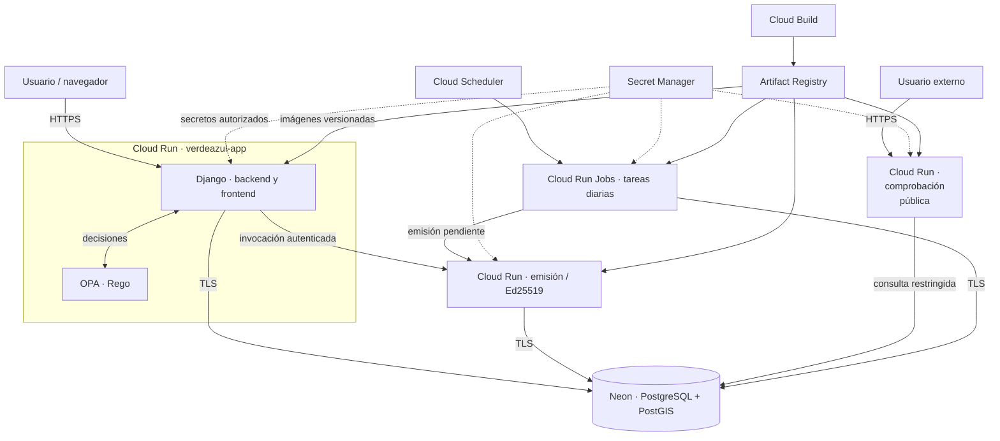

<h1 align="center"> Verdeazul Carbono</h1>

<p align="center">
  <strong>Sistema seguro de registro, verificación y certificación de carbono</strong><br>
  CE-1115 · Seguridad de la Información · Instituto Tecnológico de Costa Rica<br>
</p>

<div align="center">

<a href="https://verdeazul-app-708901712393.us-east1.run.app"></a>

<strong>Tecnologías principales</strong>

<a href="https://www.python.org/"></a>
<a href="https://www.djangoproject.com/"></a>
<a href="https://www.docker.com/"></a>
<a href="https://www.openpolicyagent.org/"></a>
<a href="https://www.postgresql.org/"></a>
<a href="https://postgis.net/"></a>
<a href="https://cloud.google.com/run"></a>
<a href="https://neon.tech/"></a>
<a href="https://github.com/features/actions"></a>

</div>

---

##  ¿Qué es Verdeazul Carbono?

Verdeazul Carbono es una aplicación web para gestionar información de **fincas, parcelas, mediciones y certificados de carbono**. Su objetivo central es aplicar controles de seguridad reales: que cada persona pueda hacer **solo lo que le corresponde**, que las operaciones sean auditables y que los certificados puedan comprobarse sin confiar únicamente en la interfaz.

**Ejemplo de flujo:** un técnico registra una medición → un verificador independiente la revisa y aprueba → el servicio de emisión genera un certificado firmado con Ed25519 → un tercero verifica el archivo o consulta el certificado por su código mediante el servicio público. Si una enmienda autorizada modifica las toneladas, el sistema puede revocar y reemitir el certificado, manteniendo el vínculo entre ambos.

###  Accesos rápidos

| Quiero… | Ir a… |
|---|---|
| Abrir el sistema desplegado | [Aplicación pública en Cloud Run](https://verdeazul-app-708901712393.us-east1.run.app) |
| Entender dónde está cada función | [Guía de carpetas](#guía-de-carpetas-y-archivos) |
| Ejecutar el sistema en mi computadora | [Desarrollo local](#desarrollo-local) |
| Conocer las herramientas y su propósito | [Tecnologías](#tecnologías-qué-hace-cada-una) |
| Consultar versiones de Verdeazul | [Despliegue y versiones](#despliegue-en-google-cloud) |
| Consultar la matriz y los documentos de diseño | [Parte 1: diseño original](https://github.com/Randall-BL/CE1115-Proyecto-P1-Verdeazul) |

##  ¿Qué permite hacer el sistema?

- **Registrar y gestionar fincas y parcelas** con información geoespacial.
- **Capturar, enviar, revisar y aprobar mediciones**, manteniendo su historial.
- **Administrar cuentas, roles, asignaciones, períodos y alertas**, según los permisos definidos.
- **Proteger las operaciones** mediante autenticación multifactor, reglas de acceso y restricciones en la base de datos.
- **Registrar acciones en una bitácora encadenada** para detectar modificaciones no autorizadas.
- **Emitir, revocar y reemitir certificados firmados digitalmente** con Ed25519; verificar su integridad desde el servicio público o con un verificador independiente de línea de comandos.
- **Ejecutar trabajos programados** para vencimientos, escalamiento de alertas, revisión de auditoría y sellado temporal de la bitácora (RFC 3161).

### Roles principales

| Rol | ¿Qué hace? |
|---|---|
| **TEC** — Técnico | Registra y envía mediciones de fincas asignadas. |
| **VER** — Verificador | Revisa y aprueba o devuelve mediciones; no aprueba las que registró. |
| **SUP** — Supervisor | Gestiona asignaciones de técnicos y atiende alertas. |
| **GER** — Gerencia | Autoriza decisiones y aprueba cambios sensibles. |
| **ADM** — Administrador | Gestiona cuentas y propuestas de cambios administrativos. |
| **AUD** — Auditor | Consulta y exporta información de auditoría dentro de su ventana autorizada. |
| **DUE** — Dueño | Consulta únicamente sus datos y operaciones permitidas. |
| **SIS / PUB / OPE** | Servicios de emisión y consulta pública / operador de infraestructura. No son cuentas humanas comunes de la aplicación. |

El diseño define **102 permisos concedidos y 38 celdas denegadas**. Según el seguimiento del equipo al 15 de noviembre, están cubiertos los **41 casos de prueba (T-01 a T-41)** y los **102 permisos** (91 de los roles humanos, 10 de SIS y 1 de PUB). La integración continua registra **304 pruebas en total**, incluidas **192 de Django**, además de verificaciones de acceso indebido por identificador (IDOR) y de equivalencia entre OPA y la base de datos.

##  Tecnologías: ¿qué hace cada una?

| Tecnología | Función dentro de Verdeazul |
|---|---|
| **Python + Django** | Backend principal, autenticación, vistas, formularios, reglas de negocio y generación de páginas. |
| **Flask + Gunicorn** | Servicios separados de emisión y comprobación pública de certificados. |
| **HTML + CSS + plantillas Django** | Frontend: pantallas y navegación según la sesión y el rol. |
| **Open Policy Agent (OPA) + Rego** | Motor que evalúa las decisiones de acceso usando la matriz de roles, acciones y condiciones. |
| **PostgreSQL + PostGIS** | Almacenamiento de usuarios, fincas, geometrías, mediciones, permisos y auditoría. |
| **Docker + Docker Compose** | Contenedores reproducibles para ejecutar el sistema y sus dependencias. |
| **Google Cloud Run** | Ejecución de la aplicación y de los servicios de emisión y comprobación pública; el servicio de emisión está restringido a invocadores autorizados. |
| **Cloud Run Jobs + Cloud Scheduler** | Ejecución diaria de vencimientos, alertas, verificación de la bitácora y tareas de emisión pendientes. |
| **Neon** | Servicio administrado que aloja PostgreSQL en la nube. |
| **Secret Manager** | Almacena claves de Django y MFA, conexiones independientes por servicio y la clave privada Ed25519 de firma, con permisos de lectura restringidos. |
| **Ed25519 + RFC 3161** | Firma y comprobación de certificados y exportaciones; sellado de tiempo externo de la bitácora. |
| **Artifact Registry + Cloud Build** | Construcción y almacenamiento de imágenes Docker con versiones identificables. |
| **GitHub Actions + Dependabot** | Integración continua, comprobaciones automatizadas y revisión periódica de actualizaciones de dependencias. |
| **Ruff, Bandit, mypy, pip-audit y Trivy** | Análisis estático, revisión de dependencias y análisis automatizado de las imágenes de contenedor. |
| **Gitleaks** | Detección de posibles secretos antes de los commits y en la integración continua. |

##  Arquitectura resumida del sistema



**Una operación típica:** la persona inicia sesión → Django identifica su rol → consulta a OPA → la aplicación autoriza o rechaza → PostgreSQL aplica restricciones adicionales → la acción y su resultado quedan registrados cuando corresponde. En la emisión, Django invoca el servicio de firma con una identidad autorizada; el servicio público comprueba archivos o códigos sin revelar datos personales.

##  Guía de carpetas y archivos

### Backend, frontend y controles

| Ruta | ¿Qué encontrarás ahí? |
|---|---|
| `app/cuentas/` | Usuarios, roles, contraseñas, sesiones, autenticación y segundo factor (TOTP). |
| `app/negocio/` | Modelos y reglas de fincas, parcelas, mediciones, asignaciones, períodos y certificados. |
| `app/flujos/vistas/` | Vistas y acciones del negocio: fincas, cuentas, asignaciones, mediciones, alertas, etc. |
| `app/autorizacion/` | Conexión con OPA, hechos obtenidos desde la base y aplicación de permisos. |
| `app/nucleo/` | Configuración compartida, conexión/contexto de base y componentes de Django. |
| `app/nucleo/static/verdeazul/` | Archivos estáticos del frontend (CSS, marca y estilos). |
| `app/bitacora/` | Registro de eventos, bitácora encadenada y verificación de integridad. |
| `app/nucleo/emision.py` | Comunicación autenticada de Django con el servicio de emisión; recuperación de operaciones pendientes por el trabajo diario. |
| `app/requirements.in` | Dependencias directas de Python; se fijan mediante el script de infraestructura. |
| `app/Dockerfile` | Imagen del backend Django para su publicación en Cloud Run. |

### Política, infraestructura y servicios complementarios

| Ruta | ¿Para qué sirve? |
|---|---|
| `politica/matriz.json` | Fuente de verdad de los permisos de la matriz. |
| `politica/verdeazul/*.rego` | Reglas y pruebas de autorización del motor OPA. |
| `politica/Dockerfile` | Construcción de la imagen del motor de políticas. |
| `db/` | Scripts SQL, usuarios de base, restricciones y comprobaciones de datos. |
| `infra/app.service.yaml` | Configuración declarativa del despliegue en Cloud Run. |
| `infra/` | Scripts de preparación, creación de secretos, construcción y despliegue. |
| `infra/trabajos.job.yaml` | Configuración del trabajo diario en Cloud Run Jobs. |
| `infra/cobertura.py` y `docs/cobertura.md` | Generación y documentación de la cobertura de los 102 permisos, reglas y 41 casos de prueba. |
| `docker-compose.yml` | Contenedores y puertos para desarrollo local. |
| `.github/workflows/seguridad.yml` | Revisiones de seguridad ejecutadas por GitHub Actions. |
| `.github/dependabot.yml` | Configuración de revisión automática de dependencias. |
| `.githooks/` y `.gitleaks.toml` | Comprobaciones locales para evitar filtrar secretos. |
| `emision/` | Servicio Flask que firma, emite, revoca y reemite certificados; también sella exportaciones de auditoría. Incluye su `Dockerfile`. |
| `publico/` | Servicio Flask de verificación de archivos firmados y comprobación por código, sin mostrar datos personales. Incluye su `Dockerfile`. |
| `trabajos/` | Tareas diarias de vencimientos, alertas, integridad de bitácora, sellos RFC 3161 y emisiones pendientes. Incluye su `Dockerfile`. |
| `verificador/` | Herramienta de línea de comandos que verifica certificados y exportaciones sin conectarse a Verdeazul. |
| `docs/verdeazul-clave-publica.pem` y `docs/demostracion/` | Clave pública de verificación y ejemplos de certificado válido y alterado para la demostración. |
| `docs/informe/`, `docs/evidencia/` y `docs/escaneos.md` | Informe académico, evidencias de cumplimiento y resumen de verificaciones de seguridad. No incluyen credenciales de prueba. |

##  Seguridad y buenas prácticas

El proyecto aplica controles en diferentes capas:

| Control | Dónde se aplica o administra |
|---|---|
| Contraseñas con hash lento (Argon2id) | `app/cuentas/` |
| Autenticación multifactor TOTP | `app/cuentas/`, secreto `mfa-clave` |
| Control de acceso del lado del servidor | `app/autorizacion/` + OPA/Rego |
| Seguridad por fila (RLS) y restricciones SQL | PostgreSQL, scripts y migraciones del proyecto |
| Bitácora encadenada | `app/bitacora/` y funciones de PostgreSQL |
| Firma digital Ed25519 y verificación independiente | `emision/`, `publico/`, `verificador/` y clave pública en `docs/` |
| Testigo externo de tiempo RFC 3161 | `trabajos/tsa.py` y registros de la bitácora en PostgreSQL |
| Revocación y reemisión de certificados | `emision/emitir.py` y restricciones de PostgreSQL |
| Permisos por componente y credenciales separadas | Cuentas `sa-*` de Cloud Run y usuarios `va_*` en PostgreSQL |
| HTTPS y cabeceras de seguridad | Google Cloud Run y configuración de Django |
| Gestión de secretos | Google Cloud Secret Manager |
| Revisión de secretos y dependencias | Gitleaks, GitHub Actions, Dependabot, pip-audit y Trivy; comprobaciones automáticas en cada actualización. |
| Pruebas de permisos, equivalencia e IDOR | `flujos/tests_casos.py`, `flujos/tests_equivalencia.py`, `flujos/tests_idor.py` y `docs/cobertura.md` |
| Verificación del despliegue | Comprobaciones de configuración, cabeceras HTTPS y análisis automatizado documentados en `docs/escaneos.md`. |


## Desarrollo local

Para ejecutar Verdeazul Carbono en un entorno de desarrollo, se requiere tener instalados **Git y Docker Desktop** (o Docker Engine con Compose en Linux).

### 1. Preparar el entorno

Clonar el repositorio y acceder a su carpeta:

```bash
git clone https://github.com/Randall-BL/ProyectoSeguridad.git
cd ProyectoSeguridad
```

Crear el archivo de configuración local a partir de `.env.example`:

**Windows (PowerShell):**
```powershell
Copy-Item .env.example .env
```

**Linux / macOS:**
```bash
cp .env.example .env
```

Configurar en `.env` las variables requeridas para el entorno de desarrollo, incluida `DJANGO_SECRET_KEY`.

**Importante:** `.env` no debe subirse a GitHub. Las credenciales locales son independientes de los secretos de producción.

### 2. Iniciar los contenedores

Con Docker en ejecución:

```bash
docker compose up --build
```

Los servicios locales estarán disponibles en:

| Servicio | Dirección |
|---|---|
| Aplicación Django | http://127.0.0.1:8000 |
| PostgreSQL + PostGIS | `127.0.0.1:15432` |

La base de datos local utiliza una configuración de desarrollo y no debe exponerse a internet.

### 3. Preparar la base de datos

En otra terminal, ejecutar las migraciones:

```bash
docker compose exec app python manage.py migrate
```

Cargar los datos ficticios para los casos de prueba:

```bash
docker compose exec app python manage.py sembrar
```

El comando `sembrar` crea usuarios y datos de demostración. Las credenciales generadas se muestran una sola vez y deben mantenerse fuera del repositorio.

### 4. Detener el entorno

Para detener los contenedores:

```bash
docker compose down
```

Para eliminar también los volúmenes y los datos locales:

```bash
docker compose down -v
```

**Advertencia:** la opción `-v` elimina los datos almacenados en los volúmenes de Docker del proyecto.

### Seguridad del entorno local

- No utilizar credenciales de producción en desarrollo.
- No versionar archivos `.env`, contraseñas ni semillas TOTP.
- Utilizar únicamente datos ficticios para las pruebas.
- Ejecutar las pruebas de seguridad en un entorno controlado, sin afectar el despliegue público.


##  Despliegue en Google Cloud

**Aplicación pública:** https://verdeazul-app-708901712393.us-east1.run.app

**Comprobación pública de certificados:** https://verdeazul-publico-708901712393.us-east1.run.app

| Recurso | Identificación |
|---|---|
| Proyecto de Google Cloud | `verdeazul-ce1115-g6` |
| Región de Cloud Run | `us-east1` |
| Proyecto de Neon | `verdeazul` |
| Registro de imágenes | `us-east1-docker.pkg.dev/verdeazul-ce1115-g6/verdeazul` |
| Configuración del servicio | `infra/app.service.yaml` |
| Otros servicios | `verdeazul-emision` (acceso restringido) y `verdeazul-publico` (comprobación pública) |
| Trabajo programado | `verdeazul-trabajos`, disparador `verdeazul-diario` (02:30, hora de Costa Rica) |
| Secretos de conexión | Variables administradas mediante Secret Manager, separadas por servicio y con acceso restringido. |
| Clave de firma | Clave privada protegida mediante Secret Manager; clave pública disponible en `docs/verdeazul-clave-publica.pem`. |

**Instrucciones de despliegue (equipo autorizado).** Se requiere Git, la CLI de Google Cloud (`gcloud`), acceso autorizado al proyecto y los recursos y secretos previamente configurados. El despliegue se realiza desde una revisión aprobada del repositorio; nunca deben incluirse contraseñas, llaves privadas ni archivos `.env` en Git o en imágenes.

Desde la raíz del repositorio, en Git Bash o Cloud Shell:

```bash
sh infra/publicar.sh app vX.Y.Z
sh infra/desplegar.sh app vX.Y.Z
```

Los demás componentes se publican con `infra/publicar.sh`, indicando `politica`, `emision`, `publico` o `trabajos` según corresponda; su despliegue se gestiona mediante `infra/desplegar.sh` y los archivos versionados de `infra/`. Para una instalación nueva, los responsables del proyecto preparan previamente los recursos con `infra/preparar-gcp.sh` y configuran los secretos mediante `infra/crear-secretos.sh`. **No se deben volver a ejecutar estos pasos de inicialización sobre un entorno ya configurado sin revisar sus efectos.**

Antes de publicar, se revisan las pruebas y se utiliza una etiqueta nueva, sin reutilizar versiones anteriores. Después de cada despliegue se comprueba la aplicación por HTTPS, las revisiones activas de Cloud Run y el estado de las comprobaciones automáticas en GitHub Actions. Para regresar a una versión ya publicada se utiliza `sh infra/desplegar.sh app vX.Y.Z` indicando la etiqueta anterior que corresponda. Las imágenes se identifican con etiquetas de versión; **no se utiliza `latest` como única referencia**. Las etiquetas Git publicadas pueden consultarse en [Versiones del repositorio](https://github.com/Randall-BL/ProyectoSeguridad/tags).

###  Versiones documentadas

| Versión | Commit / imagen | Fecha | Cambios principales |
|---|---|---|---|
| **`v0.1.0`** | `6a0a1f8` | 2026-11-06 | Primera página pública con Django, HTTPS, conexión a Neon y ejecución sin root. |
| **`v0.2.0`** | App: `383da2f` · Política: `7b5df6e` | 2026-11-12 | RLS, bitácora, Argon2id, TOTP, sesiones revocables, OPA como sidecar y nueva interfaz. La imagen de política solo cambia `.gcloudignore` respecto al código de política de `383da2f`. |
| **`v0.3.0`** | `c8d05be` | 2026-11-12 | Flujos de catálogo, períodos, asignaciones, mediciones, enmiendas, cuentas, alertas, bitácora y exportación de auditoría; corrección de RLS para registrar mediciones. |
| **`v0.4.0`** | `c9bc8a4` | 2026-11-13 | Emisión y verificación pública de certificados Ed25519, revocación y reemisión, exportaciones selladas, verificador independiente y trabajo diario con testigo RFC 3161. |
| **`v1.0.0`** | `99067dc` | 2026-11-15 | Versión de endurecimiento: cinco imágenes sin root y versionadas, verificación de dependencias y contenedores, cobertura de permisos, pruebas de seguridad y evidencias del despliegue. |
| **`v1.0.1`** | `696e76b` | 2026-11-15 | Actualizaciones de dependencias evaluadas a partir de Dependabot, mejoras del arranque y publicación de las cinco imágenes; comprobaciones de CI correctas y nueva versión desplegada. |


##  Equipo de desarrollo

**Grupo 6 — CE-1115**  
Randall Bolaños · Javier Tenorio · Julio Varela · Axel Flores

Instituto Tecnológico de Costa Rica · II semestre de 2026.

---

<div align="center">
  <sub>Proyecto académico. La seguridad debe verificarse en el código, en el servidor, en la base de datos y mediante pruebas; las insignias y el README son documentación, no evidencia de cumplimiento.</sub>
</div>

